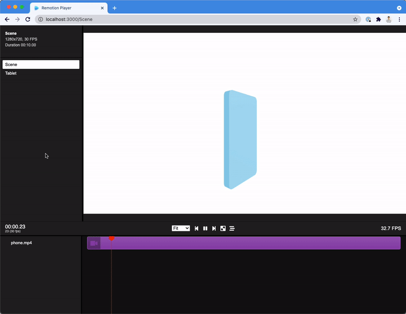

# Antes de Tudo Studio

Engine de animação educativa 3D low-poly construída com Remotion + React Three Fiber.

## Episódio 01 — "E se você acordasse há 100 mil anos?" (V2.2)

- Composição `Episodio01`: 720x1280, 30fps, 1350 frames (45s), 6 atos com ações reais.
- Story Engine declarativo: cenas com narração, legenda, ações, ambiente/eventos, plano/movimento de câmera, áudio, transições e eventos visuais.
- Personagem low-poly com rig de ações compostas (idle, walk, run, look, point, react, crouch, pickUp, interact, wake, shiver) e transições suaves.
- Câmera com shots reutilizáveis (establishing, close-up, medium, tracking, pan, dolly in/out, reaction), ancorada ao personagem quando necessário.
- Legendas dinâmicas com destaque de palavras, entrada/saída animadas e margens seguras em 9:16.
- Infraestrutura de áudio Remotion com narração, SFX, trilha e ducking; sem arquivos fabricados (cues com `available: false`).
- Storyboard visual em `Episodio01Storyboard` (1080x3000) para revisão antes da renderização.
- Ambiente com ciclo dia/noite procedural, intensidade de fogo e neblina.
- Composição antiga preservada em `Episodio01Legacy` (900 frames / 30s).
- Toda animação é controlada por `useCurrentFrame()`; sem `requestAnimationFrame`, timers ou relógio.
- Precisão histórica tratada como hipótese, com aviso na tela e no storyboard.

### Estrutura
```text
src/
  core/          # câmera, iluminação, céu, paleta, matemática
  characters/    # personagem low-poly e rig de ações
  environments/  # terreno, montanhas, caverna, vegetação, pedras, estado do ambiente
  effects/       # fogueira, partículas e chuva
  storytelling/  # tipos, legendas, áudio, transições, efeitos, storyboard
  episodes/
    episode-001/ # dados do episódio e composição
  components/    # overlays compartilhados
```

### Comandos
```console
npm install
npm run dev
npm run lint
npx remotion render Episodio01 out/episodio01-v2.mp4 --codec=h264 --concurrency=1 --gl=swangle
npx remotion still Episodio01Storyboard out/storyboard.png
npx remotion render Episodio01Legacy out/episodio01-legacy.mp4 --gl=swangle
```

> Em Codespaces/SwiftShader, use `--gl=swangle` e `--concurrency=1`.

### Áudio
Nenhum arquivo de áudio real está incluído. Veja `public/audio/README.md`.

---

## Template original (Remotion + React Three Fiber)

<p align="center">
    
</p>

[This is a template repository, click "Use this template" to create a repository based off this template!](https://github.com/remotion-dev/remotion-template-three/generate)

This is a lightweight boilerplate for [Remotion](https://github.com/remotion-dev/remotion) with [React Three Fiber](https://github.com/pmndrs/react-three-fiber) and [@remotion/three](https://remotion.dev/docs/three) preinstalled.

- [Remotion documentation](https://remotion.dev)
- [React Three Fiber documentation](https://docs.pmnd.rs/react-three-fiber)
- [@remotion/three documentation](https://remotion.dev/docs/three)

This example features a phone with a screen. You can easily switch out the video and change a series of parameters, like size, color, aspect ratio, corner radius etc. of the phone.

You can also simply delete everything inside the canvas to start off with your own 3D project.

## Commands

**Install Dependencies**

```console
npm i --loglevel=error
```

**Start Preview**

```console
npm run dev
```

**Render MP4 video**

```console
npx remotion render
```

**Upgrade Remotion**

```console
npx remotion upgrade
```

## Docs

Get started with Remotion by reading the [fundamentals page](https://www.remotion.dev/docs/the-fundamentals).

## Help

We provide help on our [Discord server](https://discord.gg/6VzzNDwUwV).

## Issues

Found an issue with Remotion? [File an issue here](https://github.com/remotion-dev/remotion/issues/new).

## License

Note that for some entities a company license is needed. [Read the terms here](https://github.com/remotion-dev/remotion/blob/main/LICENSE.md).

The content of this template is licensed under MIT.
